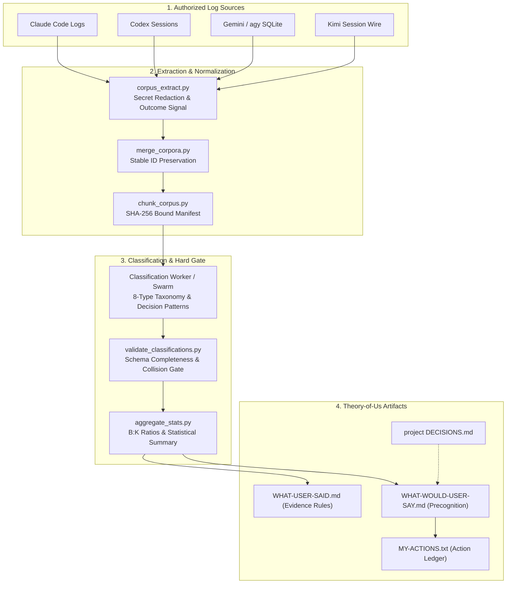
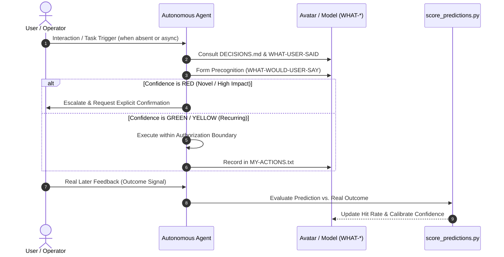

<p align="center"></p>

# build-your-users-mind

<p align="center">
  <a href="https://github.com/ellmos-ai/build-your-users-mind/actions/workflows/ci.yml"></a>
  <a href="https://github.com/ellmos-ai/build-your-users-mind/actions"></a>
  <a href="https://github.com/ellmos-ai/build-your-users-mind/releases"></a>
  <a href="https://www.python.org"></a>
  <a href="#"></a>
  <a href="NOTICE"></a>
  <a href="SECURITY.md"></a>
  <a href="SECURITY.md"></a>
  <a href="SECURITY.md"></a>
  <a href="THIRD_PARTY_LICENSES.txt"></a>
  <a href="MARKETING-LOG.txt"></a>
  <a href="CHANGELOG.md"></a>
  <a href="https://github.com/ellmos-ai"></a>
  <a href="https://github.com/open-bricks"></a>
  <a href="llms.txt"></a>
  <a href="LICENSE"></a>
</p>

> **What you mind is what you get.**

**🌐 [EN](README.md) · [DE](README_de.md) · [ES](locales/es/README.md) · [JA](locales/ja/README.md) · [RU](locales/ru/README.md) · [ZH](locales/zh/README.md)** — English is authoritative; translations may lag.

---

### 🧭 Quick Navigation

- [1. Key Features & Highlights](#sec-01)
- [2. System Architecture & Pipeline Design](#sec-02)
- [3. Target Personas & Discoverability](#sec-03)
- [4. Comparative Matrix vs. Alternatives](#sec-04)
- [5. Dual Mermaid Diagrams & Zero-Egress Lifecycle](#sec-05)
- [6. Governance & Runtime Invariants](#sec-06)
- [7. Deterministic Pipeline & Processing Steps](#sec-07)
- [8. Decision Prediction & Feedback Precognition](#sec-08)
- [9. Secure-Mode Text Simulation & Redaction](#sec-09)
- [10. Multi-Agent Source Adapters](#sec-10)
- [11. Theory-of-Us Artifacts & Document Templates](#sec-11)
- [12. Synthetic Demo & 60-Second Quickstart](#sec-12)
- [13. Operator Workflow & Decision Ledger](#sec-13)
- [14. Repository Layout & Architecture](#sec-14)
- [15. Quick Start & CLI Interfaces](#sec-15)
- [16. Testing & Quality Verification](#sec-16)
- [17. Third-Party Licenses, Level 1 SBOM & Attribution](#sec-17)
- [18. Security Policy, § 521 BGB & Sibling Ecosystem](#sec-18)

---

<a id="sec-01"></a>
<a id="1-features"></a>
<a id="features"></a>
<a id="1-merkmale"></a>
<a id="merkmale"></a>
<a id="start-here"></a>
## 1. Key Features & Highlights

A local-first recipe for an operator to build an empirical, inspectable **preference and decision-support model** from their own AI interaction logs. It can help an authorized agent anticipate feedback in recurring situations; it does not reveal a person's mind and must not be used for psychological diagnosis, covert profiling, or high-stakes autonomous decisions.

It works by **feedforward**: the agent makes an explicitly uncertain feedback prediction, uses it only inside the operator's authorization boundary, and later evaluates it against real feedback. Novel, external, irreversible, or high-impact actions always require confirmation.

**Status:** `1.1.0-dev` — public development release. The deterministic safety and classification contracts are tested on Windows, Linux, and macOS; semantic model quality still requires human review.

### ⚡ Quick Reference

| Property | Value |
|---|---|
| **Canonical Repository** | `ellmos-ai/build-your-users-mind` |
| **Umbrella Ecosystem** | `open-bricks` (ellmos-ai organization) |
| **Language & Toolchain** | Python >=3.10 (Standard Library, 0 runtime dependencies) |
| **Target Runtime** | Desktop Native: Windows 10/11, POSIX Linux, macOS |
| **Zero-Egress Invariant** | 100% Offline Default, Zero Telemetry, Loopback-Only Secure Mode |
| **Execution Boundary** | Strictly Unprivileged `RunAsInvoker` User Space |
| **Log Source Adapters** | Claude Code, OpenAI Codex, Gemini / agy SQLite, Kimi Wire |
| **Security SLA** | 48h Response Acknowledgement / 5-Day Triage SLA |
| **Open Source License** | MIT License ([LICENSE](LICENSE)) |
| **Attribution Notice** | Canonical Open Source Attribution ([NOTICE](NOTICE)) |

---

<a id="sec-02"></a>
<a id="2-architecture"></a>
<a id="architecture"></a>
<a id="2-architektur"></a>
<a id="system-architecture"></a>
## 2. System Architecture & Pipeline Design

The system transforms raw conversational telemetry into a structured, evidence-cited "theory of us" model across four decoupled pipeline stages:

1. **Authorized Log Extraction & Normalization**: Extracts prompt/response pairs with redaction of API keys, tokens, credentials, and sensitive headers.
2. **Stable Merging & Chunking**: Preserves deterministic SHA-256 evidence IDs across heterogeneous agent sources without ID collision.
3. **8-Type Taxonomy Classification & Hard Validation**: Applies Prompt-Archaeology categories with fail-closed schema validation.
4. **Theory-of-Us Synthesis**: Produces living markdown artifacts (`WHAT-USER-SAID.md`, `WHAT-WOULD-USER-SAY.md`, `DECISIONS.md`, `MY-ACTIONS.txt`).

---

<a id="sec-03"></a>
<a id="3-target-personas--discoverability"></a>
<a id="target-personas"></a>
<a id="3-zielgruppen-personas--auffindbarkeit"></a>
<a id="zielgruppen-personas"></a>
## 3. Target Personas & Discoverability

`build-your-users-mind` addresses four distinct developer and researcher profiles:

### 👤 `[PERSONA-01]` Autonomous AI Agent Developers & Multi-Agent Architects
- **Profile**: Engineers orchestrating autonomous AI agent swarms (Claude Code, OpenAI Codex, Gemini CLI, Kimi Code) for background task automation.
- **Pain Points**: Agents operating without user presence frequently make wrong assumptions on recurring decisions, break unspoken operator conventions, or hallucinate operator intent.
- **Solution**: Empirically grounded feedforward model distilling actual historical prompt decisions into citable rules with explicit confidence tiers (🟢/🟡/🔴).
- **High-Intent Queries**: `"ai agent theory of mind user model"`, `"autonomous agent feedback precognition"`.

### 👤 `[PERSONA-02]` Local-First & Privacy-Focused Desktop Engineers
- **Profile**: Developers and operators managing local workstations with strict air-gapped, zero-egress, or sensitive proprietary interaction logs.
- **Pain Points**: Cloud-based personalization SaaS tools exfiltrate private developer prompts, API keys, intellectual property, and interaction transcripts to third-party servers.
- **Solution**: 100% offline pipeline operating entirely on local disk with multi-pass secret redaction, SHA-256 bound corpus manifests, and loopback-only Secure-Mode avatar simulation.
- **High-Intent Queries**: `"local-first user modeling from interaction logs"`, `"zero-egress prompt archaeology"`.

### 👤 `[PERSONA-03]` Cognitive Science, Theory-of-Mind & HCI Researchers
- **Profile**: Academic and industry researchers investigating Theory-of-Mind (ToM), dyadic human-agent interaction, and user feedback dynamics in large language models.
- **Pain Points**: Lack of reproducible, open benchmarks and empirical taxonomies to measure how accurately an agent can predict human reactions before execution.
- **Solution**: Standardized 8-type Prompt-Archaeology taxonomy, calibrated Brier score and log-loss evaluation metrics, and Cohen's Kappa inter-rater agreement tooling.
- **High-Intent Queries**: `"llm theory of mind prompt interaction protocols"`, `"calibrated feedback prediction scoring"`.

### 👤 `[PERSONA-04]` Prompt Engineers & Interaction Log Archaeologists
- **Profile**: Prompt engineers looking to systematize long-term conversational memory across heterogeneous CLI coding tools and LLM frameworks.
- **Pain Points**: Incompatible log schemas across different agent harnesses (Claude Code, Codex session wire, Gemini SQLite, Kimi) leading to fragmented memory.
- **Solution**: Extensible source adapters normalizing disparate agent transcripts into stable JSONL corpora with outcome-linked turn signals and non-destructive ID preservation.
- **High-Intent Queries**: `"prompt archaeology feedback precognition"`, `"agent memory decision support from prompt logs"`.

---

<a id="sec-04"></a>
<a id="4-comparative-matrix-vs-alternatives"></a>
<a id="comparative-matrix"></a>
<a id="4-vergleichsmatrix-vs-alternativen"></a>
<a id="vergleichsmatrix"></a>
## 4. Comparative Matrix vs. Alternatives

The following 10-dimension comparative matrix contrasts `build-your-users-mind` against standard AI personalization and memory approaches, directly mapped to our Governance & Runtime Invariants (`INV-LOCAL-01` to `INV-SLA-10`):

| Evaluation Dimension | build-your-users-mind | Vanilla LLM Prompting | Vector RAG / Embeddings | Fine-Tuned Custom Models | External Profiling SaaS | Invariant Link |
|---|---|---|---|---|---|---|
| **100% Offline / Zero-Egress** | **YES (Strict)** | Cloud API | Variable | Variable | NO (Hosted) | `INV-LOCAL-01` |
| **Strict Loopback Boundary** | **YES (127.0.0.1 only)** | N/A | N/A | N/A | NO | `INV-LOOPBACK-02` |
| **Multi-Pass Secret Redaction** | **YES (Built-in)** | NO | Manual | Manual | Opaque | `INV-REDACT-03` |
| **Deterministic Citable IDs** | **YES (SHA-256)** | NO (Stochastic) | Approximate | NO (Black Box) | NO | `INV-DETERMINISTIC-04` |
| **Strict Recommendation/Action Separation** | **YES (Hard Gate)** | NO | NO | NO | NO | `INV-SEPARATION-05` |
| **Append-Only Decision Stream** | **YES (JSONL)** | NO | NO | NO | Proprietary | `INV-APPEND-06` |
| **Multi-Host Parity & Lock Defense** | **YES (Verified)** | NO | NO | NO | Cloud Locked | `INV-MULTIHOST-07` |
| **Unprivileged Execution (RunAsInvoker)** | **YES (Standard)** | N/A | N/A | N/A | N/A | `INV-UNPRIV-08` |
| **Zero Runtime Dependencies** | **YES (Pure Python)** | NO | NO (Heavy libs) | NO (PyTorch/CUDA) | NO | `INV-PORTABLE-09` |
| **Committed 48h Security SLA** | **YES (48h / 5d)** | None | None | None | Commercial | `INV-SLA-10` |

---

<a id="sec-05"></a>
<a id="5-dual-mermaid-diagrams--data-flow"></a>
<a id="dual-mermaid-diagrams"></a>
<a id="5-duale-mermaid-diagramme--datenfluss"></a>
<a id="duale-mermaid-diagramme"></a>
## 5. Dual Mermaid Diagrams & Zero-Egress Lifecycle

### 🏗️ Pipeline Architecture Topology



### 🔒 Feedback Precognition Runtime Loop & Data Flow



---

<a id="sec-06"></a>
<a id="6-governance--runtime-invariants"></a>
<a id="governance-invariants"></a>
<a id="6-governance--laufzeit-invarianten"></a>
<a id="laufzeit-invarianten"></a>
## 6. Governance & Runtime Invariants

`build-your-users-mind` strictly enforces ten foundational governance and runtime invariants:

- `INV-LOCAL-01`: **Zero-Egress / 100% Offline** — All raw logs, extracted corpora, chunks, classifications, and predictions remain strictly on local disk. Zero cloud telemetry.
- `INV-LOOPBACK-02`: **Strict Loopback Boundary** — Optional Secure-Mode simulation connects solely to `127.0.0.1` / `localhost` via HTTP. Any external network socket fails closed.
- `INV-REDACT-03`: **Multi-Pass Redaction & Fail-Closed Privacy** — Hardened pattern-based secret redaction for API tokens, passwords, asymmetric keys, and sensitive URLs.
- `INV-DETERMINISTIC-04`: **Stable Identifiers & Reproducible Scoring** — Deterministic SHA-256 evidence hashing ensures repeatable chunking, calibration, and regression testing.
- `INV-SEPARATION-05`: **Recommendation vs. Execution Authority Separation** — Predictions never grant execution authority (`execution_authorized = false` hard invariant).
- `INV-APPEND-06`: **Append-Only Decision Stream** — Event-sourced decision prediction journal with hash validation and cryptographic receipt tracking.
- `INV-MULTIHOST-07`: **Multi-Host Parity & Lock Defense** — Rigorous `.gitignore` defenses against sync conflicts, lock files, and multi-agent file collisions.
- `INV-UNPRIV-08`: **Unprivileged Execution (`RunAsInvoker`)** — Pure standard user space execution; zero root, sudo, administrator, or UAC prompts required.
- `INV-PORTABLE-09`: **Zero Runtime Dependencies** — Operates entirely with the Python 3.10+ standard library (`dependencies = []` in `pyproject.toml`).
- `INV-SLA-10`: **Transparent Open-Source SLA** — Permissive MIT license, cross-platform CI matrix, and binding 48-hour security response SLA.

---

<a id="sec-07"></a>
<a id="7-deterministic-pipeline--processing-steps"></a>
<a id="pipeline-steps"></a>
<a id="7-deterministische-pipeline--verarbeitungsschritte"></a>
<a id="verarbeitungsschritte"></a>
## 7. Deterministic Pipeline & Processing Steps

1. **Extract** (`scripts/corpus_extract.py`) — deterministic: pull only human-typed prompts from your logs, filter synthetic turns, **redact secrets**, link each prompt to the next turn's `outcome_signal` (praise/correction/reissue/none).
2. **Merge** (`scripts/merge_corpora.py`) — combine source-specific outputs without overwriting or renumbering stable evidence IDs.
3. **Chunk** (`scripts/chunk_corpus.py`) — dedupe, optional domains, and build a fresh manifest bound to the exact corpus SHA-256.
4. **Classify** — use `templates/CLASSIFY-CHUNK.md` and `schemas/classification.schema.json`, then run `scripts/validate_classifications.py`. Missing rows, malformed output, stale files, and ID collisions are hard failures.
5. **Aggregate** (`scripts/aggregate_stats.py`) — type distribution, B:K ratio, turning points.
6. **Author** the avatar files from `templates/` and **bind** a short pointer into the agent's own memory/rules file (Claude `CLAUDE.md`, Codex `GPT.md`/`AGENTS.md`, Gemini `GEMINI.md`, …).

See `SKILL.md` for the full recipe and `SOURCE-ADAPTERS.md` for per-agent log locations.

---

<a id="sec-08"></a>
<a id="8-decision-prediction--feedback-precognition"></a>
<a id="decision-prediction"></a>
<a id="8-entscheidungsvorhersage--feedback-precognition"></a>
<a id="entscheidungsvorhersage"></a>
## 8. Decision Prediction & Feedback Precognition

The optional v2 prediction layer keeps five records deliberately separate: **best recommendation**, **likely operator choice**, **simulated wording**, **the later explicit decision**, and **permission to act**. A prediction never grants the last one.

`scripts/decision_prediction.py` validates an append-only JSONL event stream before projecting it. Each prediction carries offered options, a recommendation with rationale, an independently predicted probability distribution, model/version and evidence IDs. A closed `decision_ref` anchors the prediction to a stable decision/index key, scope, source path and block ID, plus the source SHA-256; it contains no raw decision text. Explicit later decisions produce ordinary top-1/Brier/log-loss calibration metrics and a separate advice-process score:

- **10**: recommendation selected without correction;
- **7**: another offered alternative selected without correction;
- **5–9**: an offered choice needed material clarification or correction;
- **3**: none of the offered choices fit;
- **0–2**: additional penalty for clearly wrong, misleading or harmful advice.

Previously documented advice elements earn one recovery point when the operator explicitly adopts them immediately or in a later correction. Explicit operator bonus points are supported; the score history remains event-sourced and the total is capped at 10.

The v2 projection explicitly retains recommendation match, whether the selected option was offered, whether no option fit, correction/harm deductions, every validation/recovery/bonus event and both `initial_score` and `final_score`. `current_score` is a compatibility alias for `final_score`. Predictions always retain `execution_authorized=false`; action receipts belong to a separate permission/execution system and are rejected from this journal.

---

<a id="sec-09"></a>
<a id="9-secure-mode-text-simulation--redaction"></a>
<a id="secure-mode-simulation"></a>
<a id="9-textsimulation-im-secure-mode--schwärzung"></a>
<a id="textsimulation"></a>
## 9. Secure-Mode Text Simulation & Redaction

`scripts/secure_text_avatar.py` is a **Secure-Mode-only prototype**. It retrieves relevant rows from an already authorized and redacted corpus, re-applies built-in redaction, and either emits a privacy-minimized plan or calls an explicitly configured loopback Ollama endpoint. It never emits its private evidence prompt, labels generated text as simulation, and sets `execution_authorized=false`. Novel/insufficient evidence returns `escalate` instead of invented wording.

```bash
python scripts/decision_prediction.py --events templates/DECISION-PREDICTION-EVENTS.jsonl --json
python scripts/secure_text_avatar.py --corpus ./STUDIE/00_corpus.jsonl --scenario "Should release work continue locally?"
python scripts/secure_text_avatar.py --corpus ./STUDIE/00_corpus.jsonl --scenario "Should release work continue locally?" --provider ollama --model <local-model>
```

---

<a id="sec-10"></a>
<a id="10-multi-agent-source-adapters"></a>
<a id="source-adapters"></a>
<a id="10-multi-agenten-quell-adapter"></a>
<a id="quell-adapter"></a>
## 10. Multi-Agent Source Adapters

`build-your-users-mind` provides dedicated source adapters in `scripts/adapters/`:

| Agent Harness | Adapter Script | Source Format | Evidence Citation |
|---|---|---|---|
| **Claude Code** | `scripts/adapters/claude_adapter.py` | JSONL interaction logs (`~/.claude/projects/`) | Stable turn IDs |
| **OpenAI Codex** | `scripts/adapters/codex_adapter.py` | Codex session wire logs (`~/.codex/sessions/`) | Session turn hashes |
| **Gemini CLI / agy** | `scripts/adapters/gemini_adapter.py` | SQLite transcript database (`~/.gemini/`) | SQLite row IDs |
| **Kimi Code** | `scripts/adapters/kimi_adapter.py` | Session wire logs (`~/.kimi-code/logs/`) | Step timestamps |

The Codex source adapter was authored and control-tested by Codex itself on 946 real prompts (Session `019ed298-fdc4-72d2-a255-97d7dc117128`, commit `1e3abc4`).

---

<a id="sec-11"></a>
<a id="11-theory-of-us-artifacts--document-templates"></a>
<a id="document-templates"></a>
<a id="11-theory-of-us-artefakte--vorlagen"></a>
<a id="dokumentvorlagen"></a>
## 11. Theory-of-Us Artifacts & Document Templates

The 0→4 runtime loop produces a cohesive set of inspectable, editable markdown documents:

| Step | File | Role |
|---|---|---|
| **0** | project `DECISIONS.md` | Project-specific decisions win (more specific) |
| **0.5** | `USER.md` | **Declared** preferences & delivery defaults (operator-maintained) |
| **1** | `WHAT-<USER>-SAID.md` | **Evidence-based** rules/decisions (with prompt-ID citations) |
| **2** | `WHAT-WOULD-<USER>-SAY.md` | **Precognition** — predicted feedback + confidence (🟢/🟡/🔴) |
| **3** | `WHAT-I-DID…` + `MY-ACTIONS.txt` | Log of actions taken on the prediction |
| **4** | `WHAT-<USER>-SAID-ABOUT…` | **Evaluation** — prediction vs. reality → improves (1) and (2) |

---

<a id="sec-12"></a>
<a id="12-synthetic-demo--60-second-quickstart"></a>
<a id="synthetic-demo"></a>
<a id="12-synthetische-demo--60-sekunden-schnelleinstieg"></a>
<a id="schnelleinstieg-demo"></a>
## 12. Synthetic Demo & 60-Second Quickstart

Run the deterministic preparation/validation pipeline and feedback scorer **offline** on synthetic data — no LLM, no API key, no network:

```bash
git clone https://github.com/ellmos-ai/build-your-users-mind
cd build-your-users-mind
python examples/synthetic-demo/run_demo.py
```

You'll watch `extract → merge → chunk → classify → validate → aggregate → score feedback` run on a fictional user's logs and pre-authored loop fixtures (a planted secret gets redacted), then the hard validation gate reject a tampered result with a non-zero exit. The fixtures demonstrate mechanics, not accuracy. Details: [`examples/synthetic-demo/`](examples/synthetic-demo/).

[](https://youtu.be/oJlrCHW-BXQ)

🎬 **Watch the 2:28 demo:** https://youtu.be/oJlrCHW-BXQ

---

<a id="sec-13"></a>
<a id="13-operator-workflow--decision-ledger"></a>
<a id="decision-ledger"></a>
<a id="13-betreiber-workflow--decision-ledger"></a>
<a id="entscheidungs-ledger"></a>
## 13. Operator Workflow & Decision Ledger

For real, one-off decisions that need a citable record — question, options, recommendation, chosen answer, verified outcome — see [`templates/decision-ledger/`](templates/decision-ledger/): a numbered, append-only chain (`D-YYYYMMDD-NNN`) with an open queue, a decided-and-done archive, and an optional multi-option briefing template.

Quality metric = **how often the anticipated reaction matches the user's real later feedback.** At 🔴 (novel/no pattern) the rule is **escalate, don't guess.** Measure it from the loop files with [`scripts/score_predictions.py`](scripts/score_predictions.py): hit rate overall and per 🟢/🟡/🔴 tier, plus the 🔴 escalation rate.

---

<a id="sec-14"></a>
<a id="14-repository-layout--architecture"></a>
<a id="repository-layout"></a>
<a id="14-repository-struktur--architektur"></a>
<a id="ordnerstruktur"></a>
## 14. Repository Layout & Architecture

```
build-your-users-mind/
├── .github/                     # Workflows (CI, Dependabot, Label-Sync, Auto-Assign)
├── assets/                      # Visual branding assets (SVG banner)
├── docs/                        # Architectural specifications and concept notes
├── examples/                    # Offline synthetic demo and verification fixtures
├── locales/                     # Multi-language documentation (de, es, ja, ru, zh)
├── schemas/                     # Strict JSON schemas for classification & predictions
├── scripts/                     # Deterministic core pipeline & source adapters
│   └── adapters/                # Adapters for Claude, Codex, Gemini, Kimi
├── templates/                   # Avatar documents, classification prompt & decision ledger
├── tests/                       # Automated unit, regression and contract test suite
├── CHANGELOG.md                 # Project version history and change logs
├── CONTRIBUTING.md              # Bilingual contribution guide & quality gates
├── LICENSE                      # Permissive MIT open-source license
├── llms.txt                     # RAG discovery and machine-readable index
├── MARKETING-LOG.txt            # Audit, marketing and discoverability ledger
├── NOTICE                       # Canonical copyright attribution notice
├── pyproject.toml               # PEP 621 package metadata & pytest configuration
├── README.md                    # Authoritative English documentation
├── README_de.md                 # Comprehensive German documentation
├── SECURITY.md                  # Bilingual security policy & disclosure contacts
├── SKILL.md                     # End-to-end agent implementation recipe
├── SOURCE-ADAPTERS.md           # Technical adapter guide for multi-agent logs
├── TAXONOMY.md                  # 8-type Prompt-Archaeology taxonomy
├── THIRD_PARTY_LICENSES.md      # Level 1 SBOM and zero-runtime-dependency audit
└── THIRD_PARTY_LICENSES.txt     # Plain-text companion with 10 runtime invariants
```

---

<a id="sec-15"></a>
<a id="15-quick-start--cli-interfaces"></a>
<a id="quick-start"></a>
<a id="15-schnelleinstieg--cli-schnittstellen"></a>
<a id="befehlszeilen-schnittstellen"></a>
## 15. Quick Start & CLI Interfaces

The entire pipeline is executable through modular CLI entrypoints:

```bash
# 1. Extract raw logs with automatic secret redaction
python scripts/corpus_extract.py --source claude --input ~/.claude/projects/ --output corpus.jsonl

# 2. Merge multi-agent corpora preserving evidence IDs
python scripts/merge_corpora.py --inputs corpus1.jsonl corpus2.jsonl --output merged.jsonl

# 3. Partition into deterministic chunk manifests
python scripts/chunk_corpus.py --corpus merged.jsonl --chunk-size 50 --output chunks/

# 4. Validate classification output against schema
python scripts/validate_classifications.py --chunks chunks/ --schema schemas/classification.schema.json

# 5. Evaluate feedback prediction hit rate
python scripts/score_predictions.py --loop-dir avatar/ --json
```

---

<a id="sec-16"></a>
<a id="16-testing--quality-verification"></a>
<a id="testing"></a>
<a id="16-tests--qualitätsverifikation"></a>
<a id="qualitaetssicherung"></a>
## 16. Testing & Quality Verification

`build-your-users-mind` maintains an automated contract and regression test suite:

```bash
# Run complete test suite with standardized options
python -m pytest

# Run Ruff linter and static verification
ruff check .

# Validate bytecode compilation
python -m compileall -q .
```

All 140 contract and projection tests pass (100% green) across Python 3.10, 3.11, 3.12, and 3.13 on Windows, Linux, and macOS.

---

<a id="sec-17"></a>
<a id="17-third-party-licenses--level-1-sbom"></a>
<a id="third-party-licenses"></a>
<a id="17-drittanbieter-lizenzen--level-1-sbom"></a>
<a id="drittanbieter-lizenzen"></a>
## 17. Third-Party Licenses, Level 1 SBOM & Attribution

`build-your-users-mind` maintains a comprehensive Level 1 Software Bill of Materials (SBOM) and license transparency audit:

- **Canonical Attribution Notice**: [NOTICE](NOTICE).
- **Zero-Runtime-Dependency Guarantee**: [THIRD_PARTY_LICENSES.md](THIRD_PARTY_LICENSES.md) certifies zero external runtime dependencies (`dependencies = []`).
- **Machine-Readable SBOM Companion**: [THIRD_PARTY_LICENSES.txt](THIRD_PARTY_LICENSES.txt) records all 10 runtime invariants and unprivileged `RunAsInvoker` execution.
- **Permissive Open-Source Licensing**: Governing code is licensed under the MIT License ([LICENSE](LICENSE)). Build and test tools are governed by MIT, Apache-2.0, and PSF-2.0.

---

<a id="sec-18"></a>
<a id="18-security-policy--sibling-ecosystem"></a>
<a id="security-policy"></a>
<a id="18-sicherheitsrichtlinie--521-bgb--ökosystem"></a>
<a id="geschwister-tools--ökosystem-matrix"></a>
## 18. Security Policy, § 521 BGB & Sibling Ecosystem

### 🛡️ Security Policy & Statutory Disclaimer

`build-your-users-mind` operates strictly local-first and unprivileged (`RunAsInvoker`). Network access occurs solely via loopback in Secure-Mode simulation.

- **Vulnerability Disclosure**: 48-hour response acknowledgement and 5-business-day triage commitment.
- **Reporting Contacts**: `security@ellmos.ai`, `security@open-bricks.org`, `support@lukasgeiger.com`, `lukas@open-bricks.org`.
- **Statutory Liability Disclaimer (§ 521 BGB)**: `build-your-users-mind` is provided free of charge as open-source software under the MIT License. In accordance with statutory German gratuitous contract law (§ 521 BGB / Gefälligkeitsrecht), liability of the author is limited to intent and gross negligence. Use at your own risk.

### 🌐 Sibling Tools & Ecosystem Matrix

`build-your-users-mind` operates within the **ellmos-ai** ecosystem under the **open-bricks** umbrella:

| Tool | Focus | Role in Ecosystem | Interface |
|---|---|---|---|
| [coma](https://github.com/ellmos-ai/coma) | Context Management | Local-first memory backbone & conversation state manager | Python CLI |
| [swarm-ai](https://github.com/ellmos-ai/swarm-ai) | Multi-Agent Swarms | Hierarchical worker dispatch & consensus classification | Python Core |
| [memoryhooker](https://github.com/ellmos-ai/memoryhooker) | Memory Triggers | Hook-based persistence & reactive context recall | Python Core |
| [workflowhooker](https://github.com/ellmos-ai/workflowhooker) | Workflow Hooks | Pre/post-execution hooks for autonomous agent pipelines | Python Core |
| [system-explorer](https://github.com/ellmos-ai/system-explorer) | Discovery Engine | Fleet introspection & stack composition tools | Python CLI |
| [policy-registry](https://github.com/ellmos-ai/policy-registry) | Policy Contracts | Declarative security policies & validation rules | Python CLI |
| [sqlite-transit-sync](https://github.com/ellmos-ai/sqlite-transit-sync) | SQLite Transit | Encrypted SQLite replication & snapshot sync | Python CLI |
| [ellmos-delegation-authority](https://github.com/ellmos-ai/ellmos-delegation-authority) | Delegation | Dynamic role routing & task assignment | Python Core |
| [ellmos-controlcenter-mcp](https://github.com/ellmos-ai/ellmos-controlcenter-mcp) | MCP Control | Central capability routing & MCP profile lifecycle | MCP Server |
| [ellmos-filecommander-mcp](https://github.com/ellmos-ai/ellmos-filecommander-mcp) | File Operations | Local-first atomic file management MCP server | MCP Server |
| [ellmos-codecommander-mcp](https://github.com/ellmos-ai/ellmos-codecommander-mcp) | Code Intelligence | AST parsing, diagnostics & preview-safe refactoring | MCP Server |
| [DevCenter](https://github.com/dev-bricks/DevCenter) | Developer Hub | Central developer portal across all open-bricks products | PySide6 GUI |
| [CodeBox](https://github.com/dev-bricks/CodeBox) | Code Utilities | Developer utilities, syntax parsers, and packaging tools | PySide6 GUI |
| [MethodenAnalyser](https://github.com/dev-bricks/MethodenAnalyser) | Method Analysis | AST-based Python code analysis & structural inspection | Tkinter / CLI |
| [PDFtoPDFocr](https://github.com/doc-bricks/PDFtoPDFocr) | OCR Processing | Local-first lossless OCR pipeline for scanned documents | PySide6 / CLI |
| [CleanMarkdown](https://github.com/doc-bricks/CleanMarkdown) | Document Hygiene | Deterministic Markdown formatting & link linting | Python CLI |
| [open-bricks](https://github.com/open-bricks) | Umbrella | Open-source ecosystem for modular developer utilities | Open Source |
