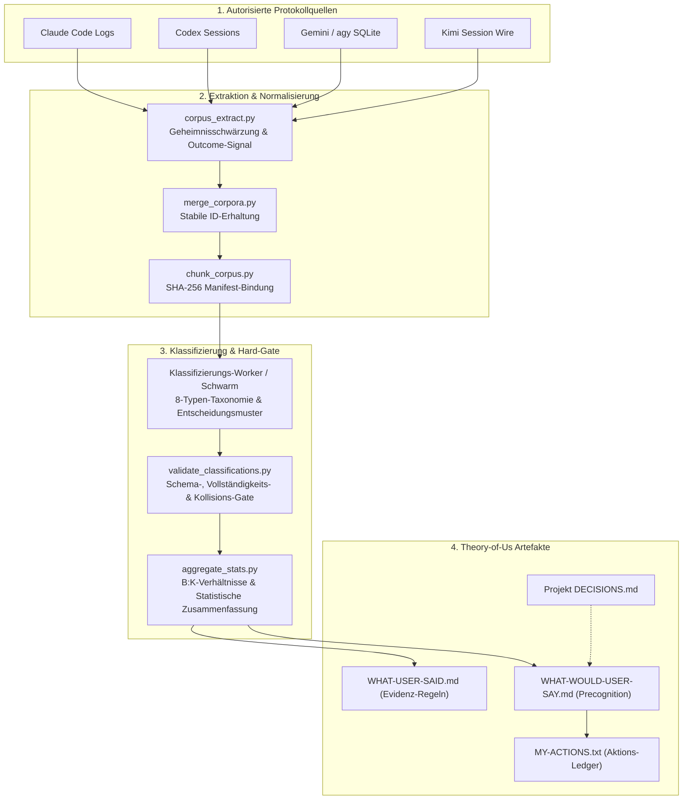
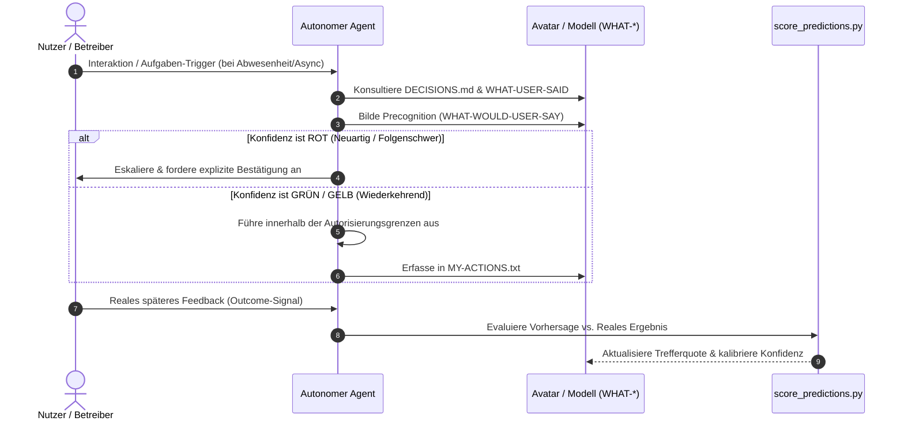

<p align="center"></p>

# build-your-users-mind

<p align="center">
  <a href="https://github.com/ellmos-ai/build-your-users-mind/actions/workflows/ci.yml"></a>
  <a href="https://github.com/ellmos-ai/build-your-users-mind/actions"></a>
  <a href="https://github.com/ellmos-ai/build-your-users-mind/releases"></a>
  <a href="https://www.python.org"></a>
  <a href="#"></a>
  <a href="NOTICE"></a>
  <a href="SECURITY.md"></a>
  <a href="SECURITY.md"></a>
  <a href="SECURITY.md"></a>
  <a href="THIRD_PARTY_LICENSES.txt"></a>
  <a href="MARKETING-LOG.txt"></a>
  <a href="CHANGELOG.md"></a>
  <a href="https://github.com/ellmos-ai"></a>
  <a href="https://github.com/open-bricks"></a>
  <a href="llms.txt"></a>
  <a href="LICENSE"></a>
</p>

> **What you mind is what you get.**

**🌐 [EN](README.md) · [DE](README_de.md) · [ES](locales/es/README.md) · [JA](locales/ja/README.md) · [RU](locales/ru/README.md) · [ZH](locales/zh/README.md)** — Englisch ist maßgeblich.

---

### 🧭 Schnellnavigation

- [1. Wichtigste Merkmale & Highlights](#sec-01)
- [2. Systemarchitektur & Pipeline-Design](#sec-02)
- [3. Zielgruppen-Personas & Auffindbarkeit](#sec-03)
- [4. 10-Dimensionale Vergleichsmatrix vs. Alternativen](#sec-04)
- [5. Duale Mermaid-Diagramme & Zero-Egress Datenfluss](#sec-05)
- [6. Governance & Laufzeit-Invarianten](#sec-06)
- [7. Deterministische Pipeline & Verarbeitungsschritte](#sec-07)
- [8. Entscheidungsvorhersage & Feedback-Precognition](#sec-08)
- [9. Textsimulation im Secure-Mode & Schwärzung](#sec-09)
- [10. Multi-Agenten Quell-Adapter](#sec-10)
- [11. Theory-of-Us Artefakte & Vorlagen](#sec-11)
- [12. Synthetische Demo & 60-Sekunden Schnelleinstieg](#sec-12)
- [13. Betreiber-Workflow & Decision Ledger](#sec-13)
- [14. Repository-Struktur & Architektur](#sec-14)
- [15. Schnelleinstieg & CLI-Schnittstellen](#sec-15)
- [16. Tests & Qualitätsverifikation](#sec-16)
- [17. Drittanbieter-Lizenzen, Level 1 SBOM & Attribution](#sec-17)
- [18. Sicherheitsrichtlinie, § 521 BGB & Ökosystem](#sec-18)

---

<a id="sec-01"></a>
<a id="1-features"></a>
<a id="features"></a>
<a id="1-merkmale"></a>
<a id="merkmale"></a>
<a id="schnelleinstieg"></a>
## 1. Wichtigste Merkmale & Highlights

Ein lokales Rezept für Betreiber, um aus ihren eigenen KI-Interaktionsprotokollen ein empirisches, überprüfbares **Präferenz- und Entscheidungsunterstützungsmodell** aufzubauen. Es hilft autorisierten Agenten, Feedback in wiederkehrenden Situationen zu antizipieren; es offenbart nicht die innere Psyche einer Person und darf nicht für psychologische Diagnostik, verdecktes Profiling oder autonome Entscheidungen mit hohem Risiko eingesetzt werden.

Es funktioniert per **Feedforward**: Der Agent trifft eine explizit mit Unsicherheit behaftete Feedback-Vorhersage, nutzt diese ausschließlich innerhalb der Autorisierungsgrenzen des Betreibers und evaluiert sie später anhand des tatsächlichen Feedbacks. Neuartige, externe, irreversible oder folgenreiche Handlungen erfordern stets eine explizite Bestätigung.

**Status:** `1.1.0-dev` — Öffentliches Entwicklungs-Release. Die deterministischen Sicherheits- und Klassifizierungsverträge sind auf Windows, Linux und macOS getestet; die semantische Modellqualität erfordert menschliche Überprüfung.

### ⚡ Schnellübersicht

| Eigenschaft | Wert |
|---|---|
| **Kanonisches Repository** | `ellmos-ai/build-your-users-mind` |
| **Dachorganisation** | `open-bricks` (ellmos-ai Organisation) |
| **Sprache & Toolchain** | Python >=3.10 (Standardbibliothek, 0 Laufzeit-Abhängigkeiten) |
| **Ziel-Laufzeitumgebung** | Desktop Nativ: Windows 10/11, POSIX Linux, macOS |
| **Zero-Egress Invariante** | 100% Offline-Standard, Null Telemetrie, Loopback-Only Secure Mode |
| **Ausführungsgrenze** | Strikt unprivilegierter `RunAsInvoker` Benutzerbereich |
| **Quell-Adapter** | Claude Code, OpenAI Codex, Gemini / agy SQLite, Kimi Wire |
| **Sicherheits-SLA** | 48h Reaktionsbestätigung / 5-Tage Triage-SLA |
| **Open-Source Lizenz** | MIT Lizenz ([LICENSE](LICENSE)) |
| **Attributions-Hinweis** | Kanonische Open-Source Attribution ([NOTICE](NOTICE)) |

---

<a id="sec-02"></a>
<a id="2-architecture"></a>
<a id="architecture"></a>
<a id="2-architektur"></a>
<a id="system-architecture"></a>
## 2. Systemarchitektur & Pipeline-Design

Das System überführt unstrukturierte Konversationsprotokolle über vier entkoppelte Pipeline-Stufen in ein strukturiertes, evidenzbasiertes "Theory of Us"-Modell:

1. **Autorisierte Protokollextraktion & Normalisierung**: Extrahiert Prompt/Antwort-Paare mit Schwärzung von API-Schlüsseln, Token, Passwörtern und sensiblen Headern.
2. **Stabiles Zusammenführen & Partitionierung**: Bewahrt deterministische SHA-256 Evidenz-IDs über heterogene Agentenquellen hinweg ohne ID-Kollisionen.
3. **8-Typen-Taxonomie Klassifizierung & Hard-Gate**: Wendet Prompt-Archaeology Kategorien mit Fail-Closed Schema-Validierung an.
4. **Theory-of-Us Synthese**: Erzeugt lebende Markdown-Artefakte (`WHAT-USER-SAID.md`, `WHAT-WOULD-USER-SAY.md`, `DECISIONS.md`, `MY-ACTIONS.txt`).

---

<a id="sec-03"></a>
<a id="3-target-personas--discoverability"></a>
<a id="target-personas"></a>
<a id="3-zielgruppen-personas--auffindbarkeit"></a>
<a id="zielgruppen-personas"></a>
## 3. Zielgruppen-Personas & Auffindbarkeit

`build-your-users-mind` richtet sich an vier spezifische Entwickler- und Forscherprofile:

### 👤 `[PERSONA-01]` Autonome KI-Agenten-Entwickler & Multi-Agenten-Architekten
- **Profil**: Ingenieure, die autonome KI-Agenten-Schwärme (Claude Code, OpenAI Codex, Gemini CLI, Kimi Code) für Hintergrundaufgaben orchestrieren.
- **Herausforderungen**: Agenten treffen bei Abwesenheit des Nutzers Fehlannahmen bei wiederkehrenden Entscheidungen oder brechen ungeschriebene Nutzerkonventionen.
- **Lösung**: Empirisch fundiertes Feedforward-Modell, das historische Prompt-Entscheidungen in zitierfähige Regeln mit klaren Konfidenzstufen (🟢/🟡/🔴) überführt.
- **Suchbegriffe**: `"ai agent theory of mind user model"`, `"autonomous agent feedback precognition"`.

### 👤 `[PERSONA-02]` Local-First & Datenschutz-fokussierte Desktop-Entwickler
- **Profil**: Entwickler und Betreiber lokaler Workstations mit strikt isolierten, Zero-Egress oder proprietären Interaktionsprotokollen.
- **Herausforderungen**: Cloud-basierte Personalisierungs-SaaS-Dienste leiten vertrauliche Prompts, API-Schlüssel und Geschäftsgeheimnisse an externe Server weiter.
- **Lösung**: 100% Offline-Pipeline auf lokaler Festplatte mit mehrstufiger Geheimnisschwärzung, SHA-256 Manifest-Bindung und Loopback-Simulation.
- **Suchbegriffe**: `"local-first user modeling from interaction logs"`, `"zero-egress prompt archaeology"`.

### 👤 `[PERSONA-03]` Kognitionswissenschaftler, Theory-of-Mind & HCI-Forscher
- **Profil**: Wissenschaftler, die Theory-of-Mind (ToM), dyadische Mensch-KI-Interaktion und Feedback-Dynamiken in LLMs untersuchen.
- **Herausforderungen**: Mangel an reproduzierbaren, offenen Benchmarks zur Messung der Vorhersagegenauigkeit von Nutzerreaktionen vor der Ausführung.
- **Lösung**: Standardisierte 8-Typen Prompt-Archaeology Taxonomie, kalibrierte Brier-Scores, Log-Loss Metriken und Cohen's Kappa Inter-Rater Reliabilität.
- **Suchbegriffe**: `"llm theory of mind prompt interaction protocols"`, `"calibrated feedback prediction scoring"`.

### 👤 `[PERSONA-04]` Prompt Engineers & Interaktionsprotokoll-Archäologen
- **Profil**: Prompt Engineers, die langfristiges Konversationsgedächtnis über heterogene CLI-Tools und LLM-Frameworks hinweg vereinheitlichen möchten.
- **Herausforderungen**: Inkompatible Protokollformate verschiedener Agenten (Claude Code, Codex Wire, Gemini SQLite, Kimi) führen zu fragmentiertem Gedächtnis.
- **Lösung**: Erweiterbare Quell-Adapter zur Normalisierung heterogener Transkripte in stabile JSONL-Korpora mit ergebnisverknüpften Signal-IDs.
- **Suchbegriffe**: `"prompt archaeology feedback precognition"`, `"agent memory decision support from prompt logs"`.

---

<a id="sec-04"></a>
<a id="4-comparative-matrix-vs-alternatives"></a>
<a id="comparative-matrix"></a>
<a id="4-vergleichsmatrix-vs-alternativen"></a>
<a id="vergleichsmatrix"></a>
## 4. 10-Dimensionale Vergleichsmatrix vs. Alternativen

Die folgende 10-dimensionale Vergleichsmatrix stellt `build-your-users-mind` alternativen Personalisierungs- und Gedächtniskonzepten gegenüber, direkt verknüpft mit unseren Governance- und Laufzeit-Invarianten (`INV-LOCAL-01` bis `INV-SLA-10`):

| Evaluierungs-Dimension | build-your-users-mind | Standard LLM-Prompting | Vektor-RAG / Embeddings | Fine-Tuned Custom Models | Externe Profiling SaaS | Invarianten-Link |
|---|---|---|---|---|---|---|
| **100% Offline / Zero-Egress** | **JA (Strikt)** | Cloud-API | Variabel | Variabel | NEIN (Hosted) | `INV-LOCAL-01` |
| **Strikte Loopback-Grenze** | **JA (nur 127.0.0.1)** | N/A | N/A | N/A | NEIN | `INV-LOOPBACK-02` |
| **Mehrstufige Geheimnisschwärzung** | **JA (Integriert)** | NEIN | Manuell | Manuell | Intransparent | `INV-REDACT-03` |
| **Deterministische zitierbare IDs** | **JA (SHA-256)** | NEIN (Stochastisch) | Approximativ | NEIN (Black Box) | NEIN | `INV-DETERMINISTIC-04` |
| **Strikte Empfehlungs-/Handlungstrennung** | **JA (Hard Gate)** | NEIN | NEIN | NEIN | NEIN | `INV-SEPARATION-05` |
| **Append-Only Entscheidungsjournal** | **JA (JSONL)** | NEIN | NEIN | NEIN | Proprietär | `INV-APPEND-06` |
| **Multi-Host Parität & Lock-Schutz** | **JA (Geprüft)** | NEIN | NEIN | NEIN | Cloud-Gesperrt | `INV-MULTIHOST-07` |
| **Unprivilegierte Ausführung (RunAsInvoker)** | **JA (Standard)** | N/A | N/A | N/A | N/A | `INV-UNPRIV-08` |
| **Null Laufzeit-Abhängigkeiten** | **JA (Reines Python)** | NEIN | NEIN (Schwere Libs) | NEIN (PyTorch/CUDA) | NEIN | `INV-PORTABLE-09` |
| **Verbindliche 48h Sicherheits-SLA** | **JA (48h / 5d)** | Keine | Keine | Keine | Kommerziell | `INV-SLA-10` |

---

<a id="sec-05"></a>
<a id="5-dual-mermaid-diagrams--data-flow"></a>
<a id="dual-mermaid-diagrams"></a>
<a id="5-duale-mermaid-diagramme--datenfluss"></a>
<a id="duale-mermaid-diagramme"></a>
## 5. Duale Mermaid-Diagramme & Zero-Egress Datenfluss

### 🏗️ Pipeline-Architektur Topologie



### 🔒 Feedback-Precognition Laufzeit-Schleife & Datenfluss



---

<a id="sec-06"></a>
<a id="6-governance--runtime-invariants"></a>
<a id="governance-invariants"></a>
<a id="6-governance--laufzeit-invarianten"></a>
<a id="laufzeit-invarianten"></a>
## 6. Governance & Laufzeit-Invarianten

`build-your-users-mind` erzwingt zehn fundamentale Governance- und Laufzeit-Invarianten:

- `INV-LOCAL-01`: **Zero-Egress / 100% Offline** — Alle Rohdaten, Korpora, Chunks, Klassifizierungen und Vorhersagen verbleiben lokal. Null Cloud-Telemetrie.
- `INV-LOOPBACK-02`: **Strikte Loopback-Grenze** — Optionale Secure-Mode Simulation verbindet sich ausschließlich mit `127.0.0.1` / `localhost` über HTTP. Externe Netzwerkaufrufe schlagen fehl.
- `INV-REDACT-03`: **Mehrstufige Geheimnisschwärzung** — Musterbasierte Schwärzung für API-Tokens, Passwörter, asymmetrische Schlüssel und sensible URLs.
- `INV-DETERMINISTIC-04`: **Stabile Identifikatoren & Reproduzierbarkeit** — Deterministische SHA-256 Evidenz-Hashes garantieren wiederholbare Chunks und Tests.
- `INV-SEPARATION-05`: **Trennung von Empfehlung und Ausführungsautorität** — Vorhersagen autorisieren niemals Ausführungen (`execution_authorized = false`).
- `INV-APPEND-06`: **Append-Only Entscheidungsstream** — Event-basiertes Entscheidungsjournal mit Hash-Prüfung und kryptographischem Belegnachweis.
- `INV-MULTIHOST-07`: **Multi-Host Parität & Lock-Schutz** — `.gitignore`-Härtung gegen Synchronisationskonflikte, Lock-Dateien und Agenten-Kollisionen.
- `INV-UNPRIV-08`: **Unprivilegierte Ausführung (`RunAsInvoker`)** — Standard-Benutzerbereich; keine Administrator-, Root- oder UAC-Rechte erforderlich.
- `INV-PORTABLE-09`: **Null Laufzeit-Abhängigkeiten** — Läuft vollständig mit der Python 3.10+ Standardbibliothek (`dependencies = []` in `pyproject.toml`).
- `INV-SLA-10`: **Transparente Open-Source SLA** — Permissive MIT-Lizenz, plattformübergreifende CI-Matrix und 48-Stunden Sicherheitsreaktions-SLA.

---

<a id="sec-07"></a>
<a id="7-deterministic-pipeline--processing-steps"></a>
<a id="pipeline-steps"></a>
<a id="7-deterministische-pipeline--verarbeitungsschritte"></a>
<a id="verarbeitungsschritte"></a>
## 7. Deterministische Pipeline & Verarbeitungsschritte

1. **Extrahieren** (`scripts/corpus_extract.py`) — Deterministisch: Liest menschliche Prompts aus Logs, schwärzt Geheimnisse und verknüpft Prompts mit Outcome-Signalen.
2. **Zusammenführen** (`scripts/merge_corpora.py`) — Kombiniert quellspezifische Ausgaben unter Erhalt stabiler Evidenz-IDs.
3. **Partitionieren** (`scripts/chunk_corpus.py`) — Deduplizierung und Erstellung frischer, an SHA-256 gebundener Manifeste.
4. **Klassifizieren** — Nutzt `templates/CLASSIFY-CHUNK.md` und `schemas/classification.schema.json`, validiert durch `scripts/validate_classifications.py`.
5. **Aggregieren** (`scripts/aggregate_stats.py`) — Typverteilung, B:K-Verhältnisse und Wendepunkte.
6. **Verfassen & Binden** — Erstellt Avatar-Dateien aus Vorlagen und bindet sie in die Agentenregeln ein (`CLAUDE.md`, `GPT.md`, `GEMINI.md`).

---

<a id="sec-08"></a>
<a id="8-decision-prediction--feedback-precognition"></a>
<a id="decision-prediction"></a>
<a id="8-entscheidungsvorhersage--feedback-precognition"></a>
<a id="entscheidungsvorhersage"></a>
## 8. Entscheidungsvorhersage & Feedback-Precognition

Die v2-Vorhersageschicht hält fünf Datensätze strikt getrennt: **beste Empfehlung**, **wahrscheinliche Betreiberwahl**, **simulierte Formulierung**, **spätere explizite Entscheidung** und **Handlungsautorisierung**. Eine Vorhersage gewährt niemals Letzteres.

`scripts/decision_prediction.py` validiert einen Append-Only Event-Stream. Spätere explizite Entscheidungen erzeugen Standard-Brier/Log-Loss Metriken und einen Advice-Process Score:

- **10**: Empfehlung ohne Korrektur übernommen;
- **7**: Andere angebotene Alternative ohne Korrektur gewählt;
- **5–9**: Angebotene Auswahl erforderte Klärung oder Korrektur;
- **3**: Keine der Optionen passte;
- **0–2**: Zusätzlicher Abzug für irreführenden oder schädlichen Rat.

---

<a id="sec-09"></a>
<a id="9-secure-mode-text-simulation--redaction"></a>
<a id="secure-mode-simulation"></a>
<a id="9-textsimulation-im-secure-mode--schwärzung"></a>
<a id="textsimulation"></a>
## 9. Textsimulation im Secure-Mode & Schwärzung

`scripts/secure_text_avatar.py` ist ein **Secure-Mode Prototyp**. Er filtert relevante Zeilen aus einem autorisierten, geschwärzten Korpus, wendet Schwärzungsregeln an und gibt entweder einen Plan aus oder nutzt einen Loopback-Ollama-Endpunkt (`127.0.0.1`). Unzureichende Evidenz führt zu `escalate` statt Spekulation.

```bash
python scripts/decision_prediction.py --events templates/DECISION-PREDICTION-EVENTS.jsonl --json
python scripts/secure_text_avatar.py --corpus ./STUDIE/00_corpus.jsonl --scenario "Should release work continue locally?"
```

---

<a id="sec-10"></a>
<a id="10-multi-agent-source-adapters"></a>
<a id="source-adapters"></a>
<a id="10-multi-agenten-quell-adapter"></a>
<a id="quell-adapter"></a>
## 10. Multi-Agenten Quell-Adapter

Spezifische Quell-Adapter in `scripts/adapters/`:

| Agenten-Harness | Adapter-Skript | Quell-Format | Evidenz-Zitierung |
|---|---|---|---|
| **Claude Code** | `scripts/adapters/claude_adapter.py` | JSONL Interaktionslogs (`~/.claude/projects/`) | Stabile Turn-IDs |
| **OpenAI Codex** | `scripts/adapters/codex_adapter.py` | Codex Session Wire Logs (`~/.codex/sessions/`) | Session-Turn Hashes |
| **Gemini CLI / agy** | `scripts/adapters/gemini_adapter.py` | SQLite Transkript-DB (`~/.gemini/`) | SQLite Zeilen-IDs |
| **Kimi Code** | `scripts/adapters/kimi_adapter.py` | Session Wire Logs (`~/.kimi-code/logs/`) | Schritt-Zeitstempel |

---

<a id="sec-11"></a>
<a id="11-theory-of-us-artifacts--document-templates"></a>
<a id="document-templates"></a>
<a id="11-theory-of-us-artefakte--vorlagen"></a>
<a id="dokumentvorlagen"></a>
## 11. Theory-of-Us Artefakte & Vorlagen

Die 0→4 Laufzeitschleife erzeugt transparente, editierbare Dokumente:

| Stufe | Datei | Rolle |
|---|---|---|
| **0** | Projekt `DECISIONS.md` | Projektspezifische Entscheidungen haben Vorrang |
| **0.5** | `USER.md` | **Deklarierte** Präferenzen & Auslieferungs-Standards |
| **1** | `WHAT-<USER>-SAID.md` | **Evidenzbasierte** Regeln (mit Prompt-Zitaten) |
| **2** | `WHAT-WOULD-<USER>-SAY.md` | **Precognition** — Vorhersage + Konfidenz (🟢/🟡/🔴) |
| **3** | `WHAT-I-DID…` + `MY-ACTIONS.txt` | Protokoll der ausgeführten Aktionen |
| **4** | `WHAT-<USER>-SAID-ABOUT…` | **Evaluation** — Vorhersage vs. Realität |

---

<a id="sec-12"></a>
<a id="12-synthetic-demo--60-second-quickstart"></a>
<a id="synthetic-demo"></a>
<a id="12-synthetische-demo--60-sekunden-schnelleinstieg"></a>
<a id="schnelleinstieg-demo"></a>
## 12. Synthetische Demo & 60-Sekunden Schnelleinstieg

Führe die deterministische Validierungspipeline und den Feedback-Scorer **offline** auf synthetischen Daten aus:

```bash
git clone https://github.com/ellmos-ai/build-your-users-mind
cd build-your-users-mind
python examples/synthetic-demo/run_demo.py
```

🎬 **Video-Demo ansehen (2:28 min):** https://youtu.be/oJlrCHW-BXQ

---

<a id="sec-13"></a>
<a id="13-operator-workflow--decision-ledger"></a>
<a id="decision-ledger"></a>
<a id="13-betreiber-workflow--decision-ledger"></a>
<a id="entscheidungs-ledger"></a>
## 13. Betreiber-Workflow & Decision Ledger

Für einmalige Entscheidungen, die einen zitierfähigen Beleg benötigen, steht [`templates/decision-ledger/`](templates/decision-ledger/) bereit: Eine nummerierte Append-Only Kette (`D-YYYYMMDD-NNN`) mit offener Warteschlange und Archiv.

Qualitätsmetrik: **Wie oft entspricht die antizipierte Reaktion dem tatsächlichen späteren Feedback?** Bei 🔴 gilt: **Eskalieren, nicht spekulieren.**

---

<a id="sec-14"></a>
<a id="14-repository-layout--architecture"></a>
<a id="repository-layout"></a>
<a id="14-repository-struktur--architektur"></a>
<a id="ordnerstruktur"></a>
## 14. Repository-Struktur & Architektur

```
build-your-users-mind/
├── .github/                     # CI-Workflows, Dependabot, Label-Sync
├── assets/                      # Grafiken (SVG-Banner)
├── docs/                        # Technische Spezifikationen
├── examples/                    # Offline-Demo und synthetische Testdaten
├── locales/                     # Mehrsprachige Dokumentation
├── schemas/                     # Strikte JSON-Schemas
├── scripts/                     # Deterministische Pipeline & Quell-Adapter
├── templates/                   # Avatar-Vorlagen & Decision Ledger
├── tests/                       # Automatisierte Testsuite (pytest)
├── CHANGELOG.md                 # Versionshistorie
├── CONTRIBUTING.md              # Bilinguale Entwicklungsrichtlinien
├── LICENSE                      # MIT-Lizenz
├── llms.txt                     # RAG-Kontextindex
├── MARKETING-LOG.txt            # Lokales Marketing- und Audit-Logbuch
├── NOTICE                       # Kanonische Attributionsnotiz
├── pyproject.toml               # PEP 621 Metadaten & pytest-Konfiguration
├── README.md                    # Maßgebliche englische Dokumentation
├── README_de.md                 # Umfassende deutsche Dokumentation
├── SECURITY.md                  # Sicherheitsrichtlinie & Kontakte
├── SKILL.md                     # Agenten-Implementierungsanleitung
├── SOURCE-ADAPTERS.md           # Adapterhandbuch für Multi-Agenten-Logs
├── TAXONOMY.md                  # 8-Typen Taxonomie
├── THIRD_PARTY_LICENSES.md      # Level 1 SBOM
└── THIRD_PARTY_LICENSES.txt     # Plain-Text Begleiter mit Invarianten
```

---

<a id="sec-15"></a>
<a id="15-quick-start--cli-interfaces"></a>
<a id="quick-start"></a>
<a id="15-schnelleinstieg--cli-schnittstellen"></a>
<a id="befehlszeilen-schnittstellen"></a>
## 15. Schnelleinstieg & CLI-Schnittstellen

```bash
# 1. Prompts extrahieren mit automatischer Geheimnisschwärzung
python scripts/corpus_extract.py --source claude --input ~/.claude/projects/ --output corpus.jsonl

# 2. Multi-Agenten Korpora zusammenführen unter Erhalt stabiler IDs
python scripts/merge_corpora.py --inputs corpus1.jsonl corpus2.jsonl --output merged.jsonl

# 3. Deterministisch partitionieren
python scripts/chunk_corpus.py --corpus merged.jsonl --chunk-size 50 --output chunks/

# 4. Klassifizierung validieren
python scripts/validate_classifications.py --chunks chunks/ --schema schemas/classification.schema.json

# 5. Feedback-Precognition Trefferquote evaluieren
python scripts/score_predictions.py --loop-dir avatar/ --json
```

---

<a id="sec-16"></a>
<a id="16-testing--quality-verification"></a>
<a id="testing"></a>
<a id="16-tests--qualitätsverifikation"></a>
<a id="qualitaetssicherung"></a>
## 16. Tests & Qualitätsverifikation

```bash
# Vollständige Testsuite ausführen
python -m pytest

# Ruff Linter ausführen
ruff check .

# Bytecode-Kompilierung prüfen
python -m compileall -q .
```

Alle 140 Vertragstests bestehen (100% grün) unter Python 3.10 bis 3.13 auf Windows, Linux und macOS.

---

<a id="sec-17"></a>
<a id="17-third-party-licenses--level-1-sbom"></a>
<a id="third-party-licenses"></a>
<a id="17-drittanbieter-lizenzen--level-1-sbom"></a>
<a id="drittanbieter-lizenzen"></a>
## 17. Drittanbieter-Lizenzen, Level 1 SBOM & Attribution

- **Kanonischer Attributionshinweis**: [NOTICE](NOTICE).
- **Null-Laufzeit-Abhängigkeiten Garantie**: [THIRD_PARTY_LICENSES.md](THIRD_PARTY_LICENSES.md) zertifiziert null externe Abhängigkeiten (`dependencies = []`).
- **Maschinenlesbarer SBOM-Begleiter**: [THIRD_PARTY_LICENSES.txt](THIRD_PARTY_LICENSES.txt) dokumentiert alle 10 Invarianten und `RunAsInvoker`-Modus.
- **Permissive Open-Source Lizenzierung**: Code steht unter der MIT-Lizenz ([LICENSE](LICENSE)).

---

<a id="sec-18"></a>
<a id="18-security-policy--sibling-ecosystem"></a>
<a id="security-policy"></a>
<a id="18-sicherheitsrichtlinie--521-bgb--ökosystem"></a>
<a id="geschwister-tools--ökosystem-matrix"></a>
## 18. Sicherheitsrichtlinie, § 521 BGB & Ökosystem

### 🛡️ Sicherheitsrichtlinie & Haftungsausschluss

- **Schwachstellenmeldung**: 48-Stunden Reaktionsbestätigung und 5-Tage Triage-Zusage.
- **Meldekontakte**: `security@ellmos-ai.org`, `security@open-bricks.org`, `support@lukasgeiger.com`, `lukas@open-bricks.org`.
- **Gesetzlicher Haftungsausschluss (§ 521 BGB)**: `build-your-users-mind` wird unentgeltlich als Open-Source-Software unter der MIT-Lizenz bereitgestellt. Gemäß § 521 BGB (Gefälligkeitsrecht) ist die Haftung des Autors auf Vorsatz und grobe Fahrlässigkeit beschränkt. Die Nutzung erfolgt auf eigenes Risiko.

### 🌐 Geschwister-Tools & Ökosystem-Matrix

`build-your-users-mind` ist Teil des **ellmos-ai** Ökosystems unter dem Dach von **open-bricks**:

| Tool | Fokus | Rolle im Ökosystem | Schnittstelle |
|---|---|---|---|
| [coma](https://github.com/ellmos-ai/coma) | Kontext-Management | Local-first Gedächtnis-Backbone & State-Manager | Python CLI |
| [swarm-ai](https://github.com/ellmos-ai/swarm-ai) | Multi-Agenten Schwärme | Hierarchischer Worker-Dispatch & Konsensus | Python Core |
| [memoryhooker](https://github.com/ellmos-ai/memoryhooker) | Gedächtnis-Trigger | Reaktiver Kontext-Abruf über Hooks | Python Core |
| [workflowhooker](https://github.com/ellmos-ai/workflowhooker) | Workflow-Hooks | Lifecycle-Hooks für Agentenpipelines | Python Core |
| [system-explorer](https://github.com/ellmos-ai/system-explorer) | Discovery Engine | Flotten-Introspektion & Stack-Komposition | Python CLI |
| [policy-registry](https://github.com/ellmos-ai/policy-registry) | Richtlinien-Verträge | Deklarative Sicherheitsregeln & Validierung | Python CLI |
| [sqlite-transit-sync](https://github.com/ellmos-ai/sqlite-transit-sync) | SQLite Transit | Verschlüsselte SQLite-Replikation & Snapshots | Python CLI |
| [ellmos-delegation-authority](https://github.com/ellmos-ai/ellmos-delegation-authority) | Delegation | Dynamisches Rollen-Routing & Aufgabenzuweisung | Python Core |
| [ellmos-controlcenter-mcp](https://github.com/ellmos-ai/ellmos-controlcenter-mcp) | MCP Control | Zentrale Fähigkeitsverwaltung & Profil-Lifecycle | MCP Server |
| [ellmos-filecommander-mcp](https://github.com/ellmos-ai/ellmos-filecommander-mcp) | Dateioperationen | Lokaler atomarer Dateimanagement MCP-Server | MCP Server |
| [ellmos-codecommander-mcp](https://github.com/ellmos-ai/ellmos-codecommander-mcp) | Code-Intelligenz | AST-Parsing, Diagnostik & Refactoring | MCP Server |
| [DevCenter](https://github.com/dev-bricks/DevCenter) | Entwickler-Portal | Zentrales Entwickler-Hub aller open-bricks Produkte | PySide6 GUI |
| [CodeBox](https://github.com/dev-bricks/CodeBox) | Code-Dienstprogramme | Syntax-Parser, Viewer und Packaging-Tools | PySide6 GUI |
| [MethodenAnalyser](https://github.com/dev-bricks/MethodenAnalyser) | Methoden-Analyse | AST-basierte Python-Code-Analyse & Inspektion | Tkinter / CLI |
| [PDFtoPDFocr](https://github.com/doc-bricks/PDFtoPDFocr) | OCR-Verarbeitung | Lokale verlustfreie OCR-Pipeline für PDF-Dateien | PySide6 / CLI |
| [CleanMarkdown](https://github.com/doc-bricks/CleanMarkdown) | Dokumenten-Hygiene | Deterministisches Markdown-Formatting & Link-Linting | Python CLI |
| [open-bricks](https://github.com/open-bricks) | Dachorganisation | Modulares Open-Source-Ökosystem | Open Source |
